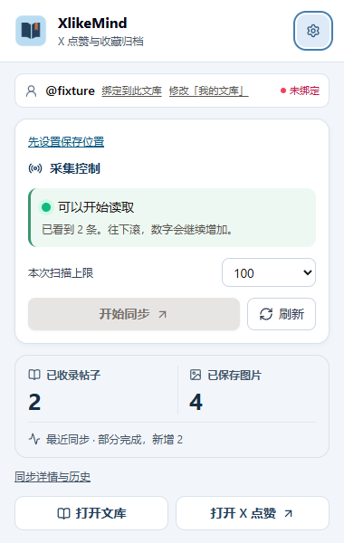
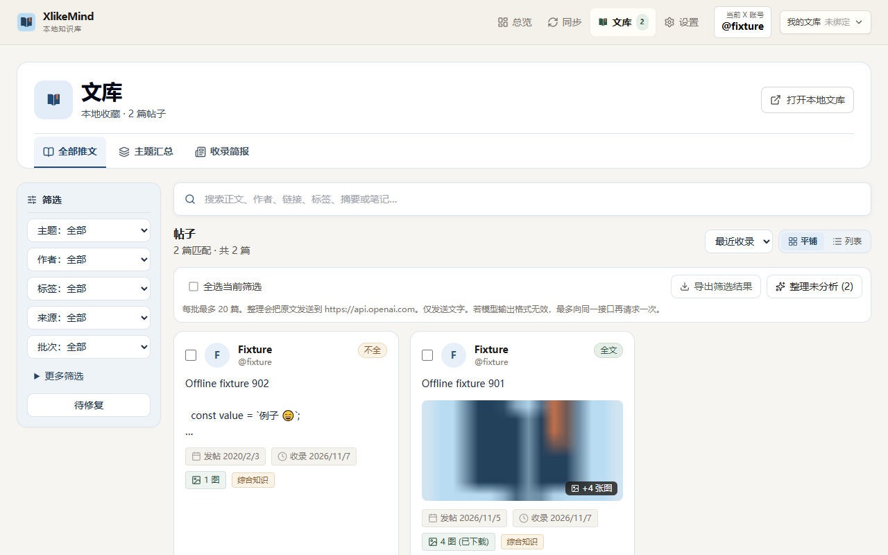

# XlikeMind

A local-first Chrome Manifest V3 extension for turning X (formerly Twitter) likes and bookmarks into a searchable, exportable, offline-readable personal library.

Current version: **v0.1.0** · License: **Apache-2.0** · Runtime: **Chrome extension** (no desktop client).

[中文](README.md) · [Installation and deployment](docs/INSTALL.md) · [API and message reference](docs/API.md) · [Privacy](PRIVACY.md) · [Changelog](CHANGELOG.md) · [License](LICENSE)

## Overview

XlikeMind saves content that is visible in the browser locally. Capture, deduplication, checkpoints, media downloads, manual curation, and export run inside the extension. AI organization is optional: content is sent to an OpenAI-compatible endpoint only after it has been configured and started from the UI.





Screenshots use offline demonstration data and contain no personal library content.

## Features

- **Bounded incremental capture**: read X likes or bookmarks in batches with a scan limit, pause/resume, and recovery after interruption.
- **Local library**: store posts, media, notes, tags, reading status, and sync runs in IndexedDB, with independent local profiles.
- **Source fidelity**: original text and AI output are stored separately; unknown like times remain null; incomplete text or media is marked explicitly.
- **Offline export**: create Markdown/HTML library ZIPs with relative image paths, or write to a user-selected local directory with an `index.html` entry point.
- **Manual curation**: search and filter by keyword, source, topic, or reading status; edit titles, tags, categories, and notes; open the source post or refresh one record.
- **Optional AI organization**: use local Ollama/LM Studio services or an OpenAI-compatible service; images are not sent by default; session-only keys and offline Mock are supported.
- **Account boundaries**: a local profile can be explicitly bound to an X handle; a mismatch or missing proof stops ingestion instead of writing to the wrong library.

## Installation and first run

See [docs/INSTALL.md](docs/INSTALL.md) for the complete guide.

### Release package

1. Download `XlikeMind-v<version>-chrome.zip` from GitHub Releases and extract it to a directory you intend to keep.
2. Open `chrome://extensions`, enable **Developer mode**, and choose **Load unpacked**.
3. Select the extracted `extension/` directory, which contains `manifest.json`.
4. Open the extension and choose or authorize a local library directory in Settings.

### Build from source

```bash
npm ci
npm run build
```

Load the generated `dist/` directory from `chrome://extensions`. To build a release ZIP:

```bash
npm run package:release
```

The package places the extension under `extension/` and includes the license, third-party notices, installation guide, and SHA-256 checksum.

## Basic workflow

1. Open the X likes or bookmarks page and refresh it so the content script can be injected.
2. Click the toolbar icon, choose a scan limit, and start a sync. The full Sync page is also available.
3. When capture finishes, search, filter, edit, or export from Library. Reaching the limit ends the current batch; it does not claim that all historical content was collected.
4. For knowledge organization, configure a local model or OpenAI-compatible endpoint under **Settings → Model and organization**, then explicitly start AI organization from the library. Browsing, editing, and exporting do not require AI.

## Architecture and design choices

```text
X page (content script)
          │ bounded messages and batch checkpoints
          ▼
Service worker (sync routing / account boundary)
          │
          ▼
IndexedDB (Dexie: posts, media, runs, notes, AI results)
          │
     ┌────┴─────┐
     ▼          ▼
Popup / dashboard  Local export directory or ZIP
                    │
                    ▼
              index.html + relative media paths
```

The project keeps data local by default, separates capture from UI, bounds scans and retries, keeps AI output out of the original record, treats missing data as incomplete rather than deleted, and produces exports that remain readable without an online service.

## Privacy and security boundaries

- The extension does not read passwords or cookies and does not like, unlike, follow, post, or modify an X account automatically.
- Diagnostics and exports do not include API keys, cookies, or session credentials. A key may be kept only for the current browser session, but browser local storage is not treated as a system-level secret vault.
- AI requests send text only by default. When image analysis is enabled, at most two downloaded images are attached. The configured provider controls its own data handling.
- There is no developer backend, telemetry, or cloud account. The extension requests only the storage, downloads, tabs, X/media, and user-approved endpoint or directory access required for its workflow.

See [PRIVACY.md](PRIVACY.md) and [docs/API.md](docs/API.md).

## Development and verification

The project uses TypeScript strict, React, Vite, Dexie, JSZip, and Vitest:

```bash
npm ci
npm run typecheck
npm run lint
npm run test
npm run build
```

`npm run build` also checks the artifact structure and permissions. Before a release, `npm run package:release` validates ZIP extraction and generates `THIRD_PARTY_NOTICES.txt` and a SHA-256 checksum. See [docs/API.md](docs/API.md) for data fields, internal messages, and AI request format.

## Project status

v0.1.0 focuses on the local Chrome extension loop: X capture, local storage, media archiving, search and editing, optional AI organization, and offline export. X page structure, login state, media availability, and provider compatibility may change; capture results keep explicit partial or failed states instead of inferring that unobserved content was archived.

Please use GitHub Issues for reproducible problems with redacted logs and environment details. Do not commit post text, cookies, API keys, or personal account data.

