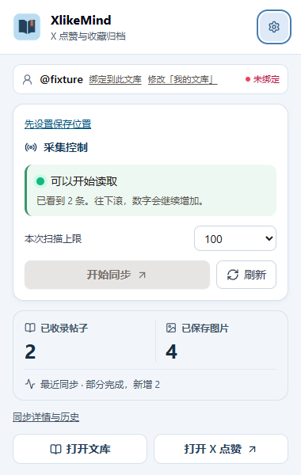
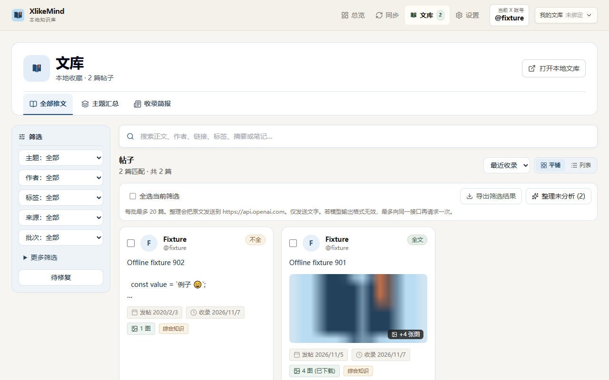

# XlikeMind

本地优先的 Chrome Manifest V3 扩展，用于把 X（原 Twitter）上的点赞和收藏整理成可搜索、可导出、可离线阅读的个人文库。

当前版本：**v0.1.0** · 许可证：**Apache-2.0** · 运行形态：**Chrome 扩展**（不包含桌面客户端）。

[English](README.en.md) · [安装与部署](docs/INSTALL.md) · [接口与消息说明](docs/API.md) · [隐私说明](PRIVACY.md) · [变更记录](CHANGELOG.md) · [许可证](LICENSE)

## 产品概览

XlikeMind 将浏览器中可见的 X 内容保存到本地。采集、去重、断点恢复、媒体下载、人工整理和导出都在扩展内完成；AI 整理是可选功能，只有在用户主动配置并启动时才会向指定的 OpenAI-compatible 接口发送内容。





以上截图使用离线演示数据，不包含个人文库内容。

## 主要功能

- **有边界的增量采集**：从 X 点赞或收藏页开始，按扫描上限分批读取；支持暂停、继续和中断恢复。
- **本地文库**：使用 IndexedDB 保存帖子、媒体、笔记、标签、阅读状态和任务记录，支持多份本地档案隔离。
- **内容保真**：原文与 AI 结果分开保存；未知的真实点赞时间保持为空；正文或媒体不完整时明确标记。
- **离线导出**：生成带相对图片路径的 Markdown/HTML 文库 ZIP，也可以写入用户选择的本地目录，目录包含可直接打开的 `index.html`。
- **人工整理**：按关键词、来源、主题和阅读状态筛选，编辑标题、标签、分类和笔记，并打开原帖或刷新单条记录。
- **可选 AI 整理**：支持本地 Ollama/LM Studio 以及 OpenAI-compatible 服务；默认不发送图片，可设置会话级密钥或离线 Mock。
- **多账号边界**：档案与 X 用户名可以显式绑定；绑定不匹配或无法确认时停止入库，避免把内容写入错误文库。

## 安装与首次使用

完整步骤见 [docs/INSTALL.md](docs/INSTALL.md)。

### 使用发行包

1. 从 GitHub Releases 下载 `XlikeMind-v<版本>-chrome.zip` 并解压到长期保留的位置。
2. 打开 `chrome://extensions`，开启「开发者模式」，点击「加载已解压的扩展程序」。
3. 选择解压目录中的 `extension/` 文件夹（该目录包含 `manifest.json`）。
4. 打开扩展，在设置中选择或授权本地文库目录。

### 从源码构建

```bash
npm ci
npm run build
```

然后在 `chrome://extensions` 加载项目生成的 `dist/` 目录。需要发布 ZIP 时运行：

```bash
npm run package:release
```

发行包会把扩展放在 `extension/` 下，并附带许可证、第三方依赖声明、安装说明和 SHA-256 校验文件。

## 基本使用

1. 在 X 打开点赞页或收藏页并刷新，使内容脚本注入。
2. 点击工具栏图标，在弹窗中选择扫描上限并开始同步；也可以打开完整控制台的「同步」页。
3. 采集完成后，在「文库」中搜索、筛选、编辑或导出。达到上限只表示本批结束，不代表历史内容已经全部读取。
4. 若需要整理知识，在「设置 → 模型与整理」中配置本地模型或 OpenAI-compatible 接口，再从文库中主动启动 AI 整理。未配置 AI 不影响原文浏览、编辑和导出。

## 架构与设计取舍

```text
X 页面（Content Script）
          │ 有界消息与批次检查点
          ▼
Service Worker（同步路由 / 账号边界）
          │
          ▼
IndexedDB（Dexie：帖子、媒体、任务、笔记、AI 结果）
          │
     ┌────┴─────┐
     ▼          ▼
Popup / 控制台   本地导出目录或 ZIP
                  │
                  ▼
            index.html + 相对媒体路径
```

核心取舍：数据默认留在浏览器本地；采集器与 UI 分离；所有扫描和重试有上限；原文不可被 AI 结果覆盖；缺失不等于删除；导出物不依赖在线服务即可阅读。这些约束优先于自动化程度。

## 隐私与安全边界

- 不读取密码或 Cookie，不自动点赞、取消点赞、关注、发帖或修改 X 账户。
- 诊断和导出不包含 API key、Cookie 或会话凭据；密钥可以只保存在当前浏览器会话中，但本项目不把浏览器本地存储当作系统级密钥保险箱。
- AI 请求默认只发送文字；开启图片分析后，最多附带两张已下载图片。第三方服务的数据处理遵循其自身政策。
- 不使用开发者后端、遥测或云端账户；扩展只申请采集、下载、标签页、本地存储以及用户主动授权的接口/目录权限。

详见 [PRIVACY.md](PRIVACY.md) 和 [docs/API.md](docs/API.md)。

## 开发与验证

项目使用 TypeScript strict、React、Vite、Dexie、JSZip 和 Vitest：

```bash
npm ci
npm run typecheck
npm run lint
npm run test
npm run build
```

`npm run build` 会同时执行产物结构和权限检查。发布前可运行 `npm run package:release`，它会校验 ZIP 解压结果、生成 `THIRD_PARTY_NOTICES.txt` 和 SHA-256 校验文件。API 字段、内部消息和 AI 请求格式见 [docs/API.md](docs/API.md)。

## 项目状态

v0.1.0 聚焦本地 Chrome 扩展闭环：X 页面采集、本地保存、媒体归档、搜索编辑、AI 可选整理和离线导出。X 页面结构、登录状态、媒体可用性和供应商 API 兼容性可能变化；采集结果会保留明确的部分完成或失败状态，不把未观测内容推断成已归档。

欢迎通过 GitHub Issues 提交可复现的问题、脱敏日志和环境信息。请勿提交帖子全文、Cookie、API key 或个人账号数据。

